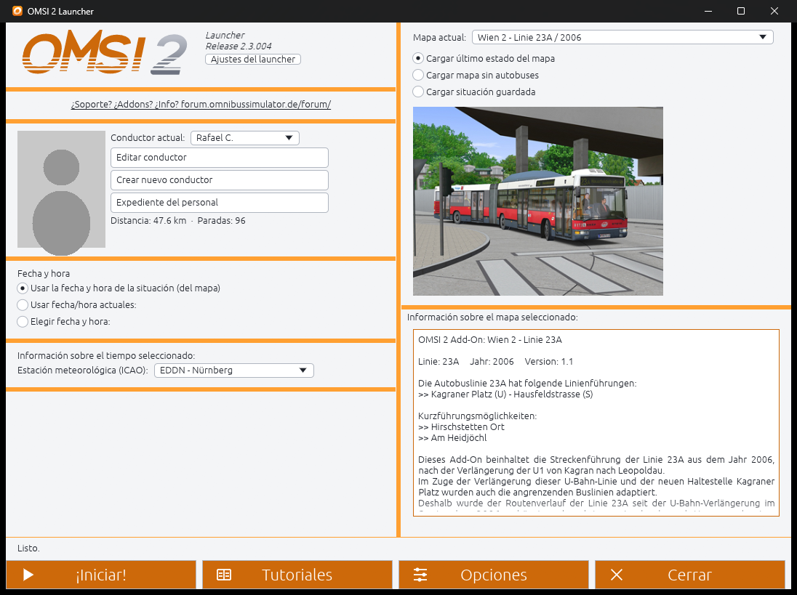
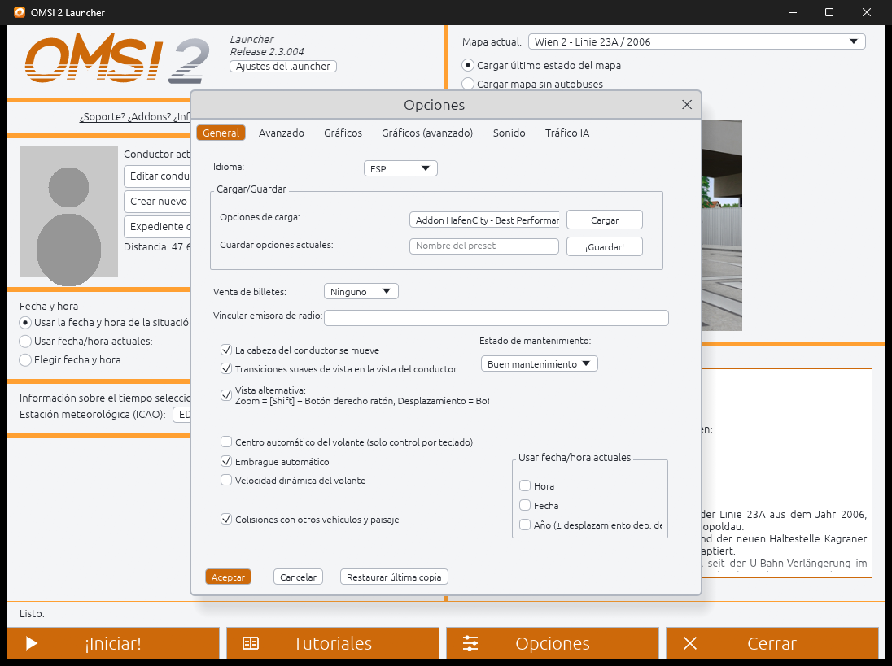
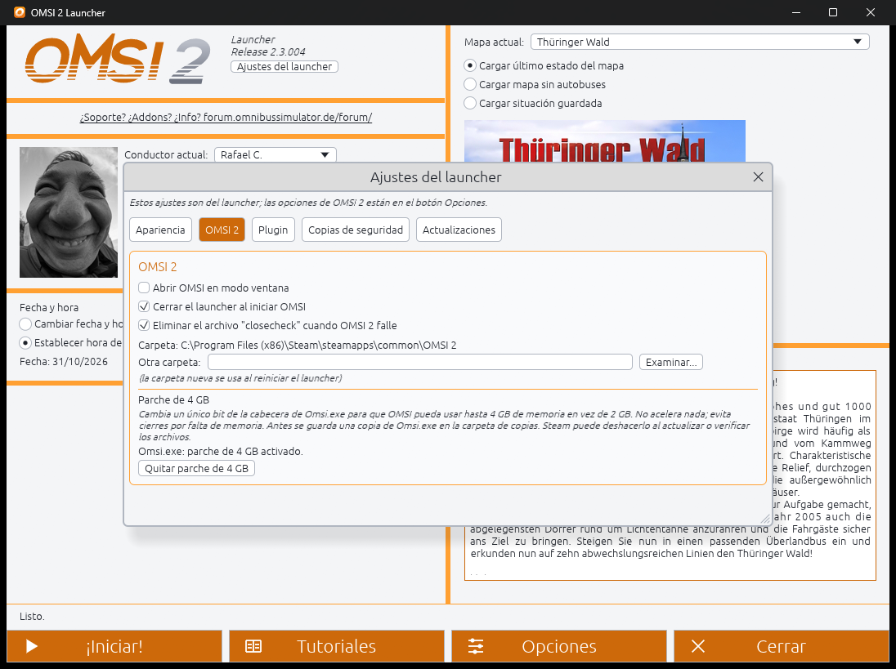
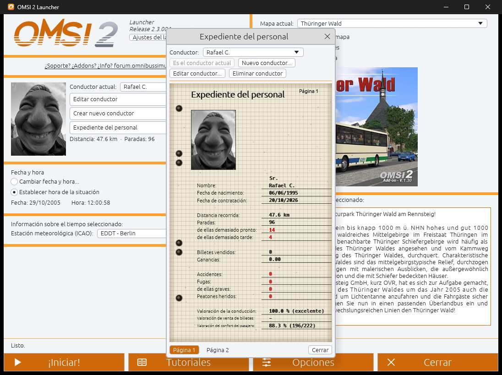
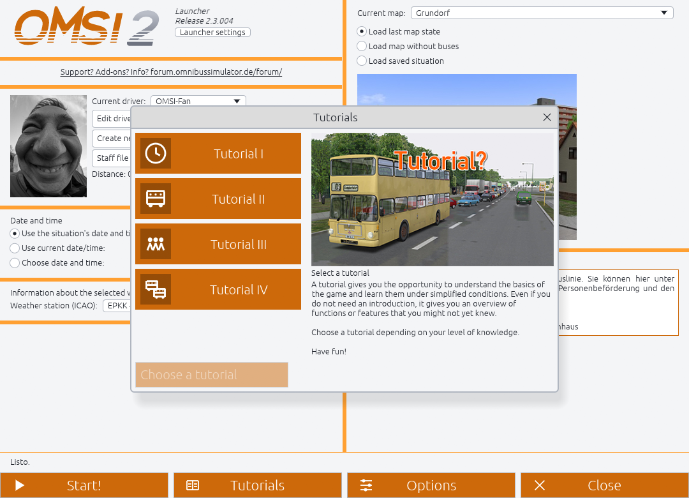

# OMSI 2 Launcher

**Un launcher rápido y moderno para el simulador de autobuses OMSI 2 original.** Elige el mapa, el conductor, la fecha y la hora, pulsa *Iniciar* y OMSI 2 se abre y carga el mapa por ti, sin pasar a mano por la pantalla de inicio.

> **Versión 0.9-beta2** — segunda versión pública de pruebas (mira las [notas de la versión](https://github.com/rafaelkaiz/OMSI2-Launcher/releases)). [English](README.md) · [Página web](https://rafaelkaiz.github.io/OMSI2-Launcher/) · [Descargar](https://github.com/rafaelkaiz/OMSI2-Launcher/releases)

## Qué hace

- **Inicio con un clic**: abre OMSI 2 Launcher, elige tu mapa y conductor y él inicia OMSI 2 y carga el mapa: último estado, mapa sin autobuses o una situación guardada.
- **Fecha y hora**: las del mapa, las actuales o las que elijas (con los atajos *Mañana 07:00 / Día 12:00 / Tarde 17:00 / Noche 00:00*), más la estación meteorológica (ICAO).
- **Elige dónde aparecer**: con "Cargar mapa sin autobuses", eliges el punto de inicio del mapa en el launcher y él responde a la ventana "Establecer posición" de OMSI.
- **Tutoriales 1–4** directamente desde el launcher.
- **La ventana de opciones de OMSI, reconstruida**: General, Avanzado, Gráficos, Gráficos (avanzado), Sonido y Tráfico IA, con la misma disposición que el original. Carga presets de opciones y guarda tus opciones actuales como un preset nuevo.
- **Conductores**: edita, crea y elimina conductores, y consulta el expediente del personal (paradas, distancia, valoración de confort, autobuses conducidos).
- **Aspecto de OMSI**: el diseño naranja original, más un tema oscuro y otro claro. Se abre a pantalla completa con una pantalla de carga que permanece hasta que OMSI está cargando el mapa (F11 alterna la pantalla completa).
- **7 idiomas**: Español, English, Deutsch, Polski, Čeština, Français, Português. La primera vez elige el idioma de Windows.
- **Elimina el archivo `closecheck`** que OMSI deja tras un cierre inesperado (opcional).
- **Busca versiones nuevas en GitHub** (solo te avisa; nunca descarga ni reemplaza nada por sí solo).

## No toca tus archivos de OMSI

El launcher se hizo con una regla: **los archivos originales de OMSI 2 nunca se modifican.** Lo único que escribe es:

| Qué | Dónde | Seguridad |
| --- | --- | --- |
| `options.cfg` | carpeta de OMSI | solo al pulsar *Aceptar* en Opciones; antes se hace una copia de seguridad |
| `Drivers\*.odr` | carpeta de OMSI | solo al editar, crear o eliminar un conductor; antes se hace una copia de seguridad |
| Archivos de preset nuevos | `option_presets\` | solo archivos nuevos, nunca sobrescribe presets existentes |
| Dos archivos del plugin | `plugins\` | `OMSI2Launcher.opl` y `OMSI2LauncherPlugin.dll`, solo al pulsar *Instalar plugin* |
| Sus ajustes, registro y copias | `%APPDATA%\OMSI2-Launcher\` | se conservan las 3 copias más recientes de cada archivo |

No escribe nada mientras OMSI 2 está en ejecución.

## El plugin

Para pulsar *Iniciar* (y los demás botones de la pantalla de inicio) sin simular clics de ratón, el launcher instala un plugin diminuto en la carpeta `plugins\` de OMSI. El plugin solo escucha órdenes del launcher y llama a los propios controladores de botón de OMSI. **En esta versión el plugin es necesario para iniciar OMSI desde el launcher**; se instala desde *Ajustes del launcher → Inicio directo (plugin)* y se quita desde el mismo sitio cuando quieras.

Por ahora el plugin solo reconoce **OMSI 2 versión 2.3.004**.

## Instalación

1. Descarga `OMSI2-Launcher-0.9-beta2-win64.zip` de la [página de versiones](https://github.com/rafaelkaiz/OMSI2-Launcher/releases) y descomprímelo donde quieras.
2. Ejecuta `OMSI2-Launcher.exe`. Encuentra OMSI 2 solo (carpetas habituales de Steam o Aerosoft); si no puede, te pregunta dónde está.
3. Abre **Ajustes del launcher** y pulsa **Instalar plugin**.
4. Elige mapa y conductor y pulsa **Iniciar**.

Windows 10/11 de 64 bits. El programa no está firmado digitalmente, así que SmartScreen o tu antivirus pueden avisar la primera vez: es un archivo nuevo y desconocido, no una amenaza detectada. Puedes revisar y compilar el código tú mismo.

## Limitaciones conocidas (beta)

- Las pestañas *Teclado* y *Controlador* de las opciones aún no están implementadas (usa las opciones propias de OMSI para eso).
- El plugin solo reconoce OMSI 2 2.3.004.
- Las traducciones al polaco y al checo aún no las ha revisado ningún hablante nativo.
- Los iconos de los tutoriales son dibujos propios del launcher, no los de OMSI.

¿Has encontrado un fallo? [Abre una incidencia](https://github.com/rafaelkaiz/OMSI2-Launcher/issues) y adjunta `%APPDATA%\OMSI2-Launcher\launcher.log` (y `plugin\plugin.log`, junto a él).

## Compilar desde el código

Necesitas [Rust](https://rustup.rs/) (edición 2024) en Windows. Los comandos están en el [README en inglés](README.md#build-from-source).

## Licencia

OMSI 2 Launcher es software libre, publicado bajo la [GNU General Public License v3.0 o posterior](LICENSE). Copyright (C) 2026 Rafael Casaucao. Puedes usarlo, estudiarlo, compartirlo y modificarlo; si distribuyes una versión modificada debes hacerlo con la misma licencia y poniendo su código fuente a disposición de quien lo reciba.

## Créditos y aviso legal

OMSI 2 es un producto de MR-Software y Aerosoft. Este es un proyecto comunitario independiente y no oficial, sin relación con ellos ni respaldado por ellos, y no contiene ningún archivo de OMSI 2. El soporte y los add-ons de OMSI están en el [foro de OMSI](https://forum.omnibussimulator.de/forum/).
