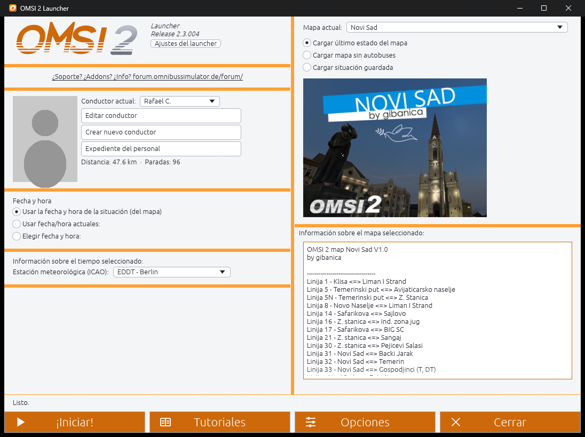
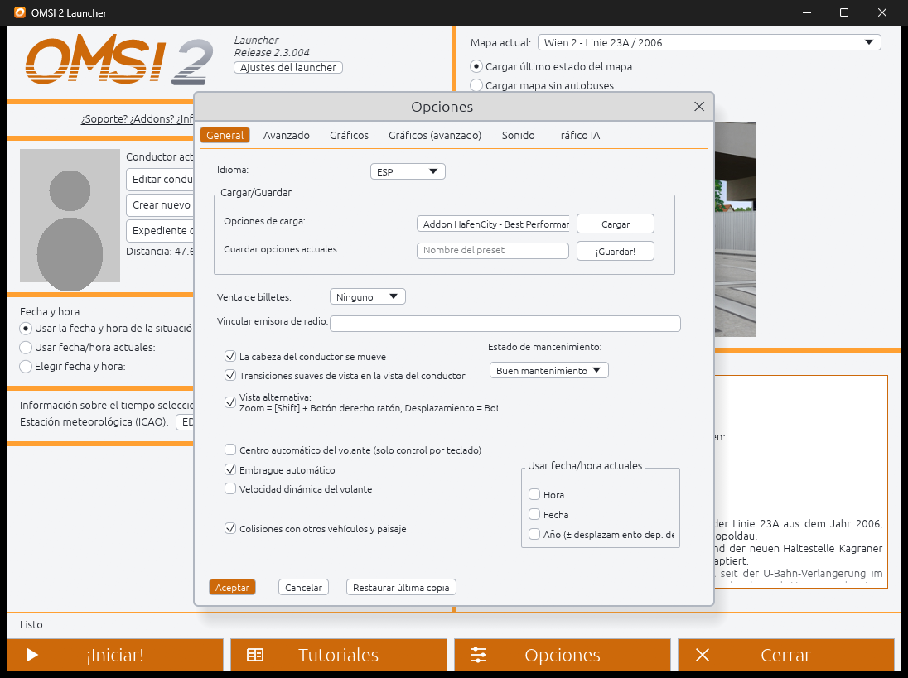

# OMSI 2 Launcher

**A fast, modern launcher for the vanilla OMSI 2 bus simulator.** Pick the map, driver, date and time, press *Start* and OMSI 2 opens and loads the map for you, with no clicking through the start screen.

> **Version 0.9-beta2** — second public test release (see the [release notes](https://github.com/rafaelkaiz/OMSI2-Launcher/releases)). [Español](README.es.md) · [Web page](https://rafaelkaiz.github.io/OMSI2-Launcher/) · [Download](https://github.com/rafaelkaiz/OMSI2-Launcher/releases)



## What it does

- **Starts OMSI 2 and loads your map** with the driver you choose: last map state, map without buses, or a saved situation.
- **Date and time**: use the map's, the current ones, or choose them (with the *Morning 07:00 / Day 12:00 / Afternoon 17:00 / Night 00:00* shortcuts), plus the weather station (ICAO).
- **Choose where to appear**: with "Load map without buses", pick the map's start place in the launcher and it answers OMSI's "Set position" window for you.
- **Tutorials 1–4** straight from the launcher.
- **OMSI's options window, rebuilt**: General, Advanced, Graphics, Graphics (advanced), Sound and AI traffic, laid out like the original. Load option presets and save your current options as a new preset.
- **Drivers**: edit, create and delete drivers, and see the staff file (stops, distance, comfort rating, buses driven).
- **Looks like OMSI**: the original orange design, plus a dark and a light theme. Opens full screen with a loading screen that stays up until OMSI is loading the map (F11 toggles full screen).
- **7 languages**: Español, English, Deutsch, Polski, Čeština, Français, Português. The first run picks your Windows language.
- **Removes the `nocheck` file** OMSI leaves behind after a crash (optional).
- **Checks GitHub for new versions** (it only tells you; it never downloads or replaces anything by itself).



## It never touches your OMSI files

The launcher was built around one rule: **the original OMSI 2 files are never modified.** The only things it writes are:

| What | Where | Safety |
| --- | --- | --- |
| `options.cfg` | OMSI folder | only when you press *Accept* in Options; a backup is made first |
| `Drivers\*.odr` | OMSI folder | only when you edit, create or delete a driver; a backup is made first |
| New preset files | `option_presets\` | new files only, existing presets are never overwritten |
| Two plugin files | `plugins\` | `OMSI2Launcher.opl` and `OMSI2LauncherPlugin.dll`, only when you press *Install plugin* |
| Its own settings, log and backups | `%APPDATA%\OMSI2-Launcher\` | the 3 newest backups of each file are kept |

Nothing is written while OMSI 2 is running.

## The plugin

To press *Start* (and the other start-screen buttons) without simulating mouse clicks, the launcher installs a tiny plugin into OMSI's `plugins\` folder. The plugin only listens for commands from the launcher and calls OMSI's own button handlers. **In this version the plugin is required to start OMSI from the launcher**; install it from *Launcher settings → Inicio directo (plugin)*, and remove it from the same place whenever you like.

The plugin currently recognises **OMSI 2 version 2.3.004** only.

## Install

1. Download `OMSI2-Launcher-0.9-beta2-win64.zip` from the [releases page](https://github.com/rafaelkaiz/OMSI2-Launcher/releases) and unzip it anywhere.
2. Run `OMSI2-Launcher.exe`. It finds OMSI 2 by itself (Steam or Aerosoft default folders); if it cannot, it asks where it is.
3. Open **Launcher settings** and press **Install plugin**.
4. Choose your map and driver and press **Start**.

Windows 10/11, 64-bit. The program is not code-signed, so Windows SmartScreen or your antivirus may warn about it the first time: it is a new, unknown file, not a detected threat. You can review and build the source yourself.

## Known limitations (beta)

- The *Keyboard* and *Controller* tabs of the options window are not implemented yet (use OMSI's own options for those).
- The plugin only recognises OMSI 2 2.3.004.
- Polish and Czech translations have not been reviewed by native speakers yet.
- The tutorial icons are the launcher's own drawings, not OMSI's.

Found a bug? Please [open an issue](https://github.com/rafaelkaiz/OMSI2-Launcher/issues) and attach `%APPDATA%\OMSI2-Launcher\launcher.log` (and `plugin\plugin.log` next to it).

## Build from source

You need [Rust](https://rustup.rs/) (edition 2024) on Windows.

```bash
# the launcher
cargo build --release

# the plugin (32-bit, because OMSI 2 is a 32-bit program); its DLL is embedded into the launcher
rustup target add i686-pc-windows-msvc
cd plugin
cargo build --release --target i686-pc-windows-msvc
copy target\i686-pc-windows-msvc\release\OMSI2LauncherPlugin.dll dist\OMSI2LauncherPlugin.dll
cd ..
cargo build --release
```

Run the tests with `cargo test --release -- --test-threads=1`. The `tools\` folder holds the PowerShell and disassembler helpers used to study OMSI's start screen.

## Credits and legal

OMSI 2 is a product of MR-Software and Aerosoft. This is an unofficial, independent community project, not affiliated with or endorsed by them, and it contains no OMSI 2 files. Support and add-ons for OMSI live at the [OMSI forum](https://forum.omnibussimulator.de/forum/).
